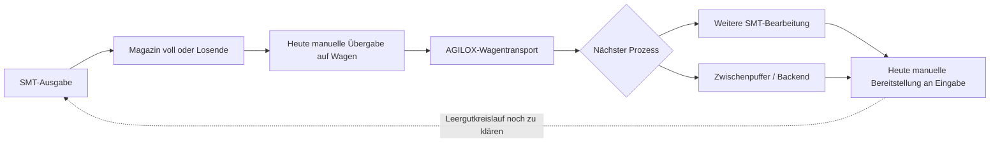

# Istprozess und Anforderungen

Stand: 29.10.2026. Quellen: Q019 Notizen, Q020 Startpräsentation, Q018 Bewegungsdaten, Bilder B001–B017. [Quellenverzeichnis](Quellenverzeichnis.md). Notizzeilen beziehen sich auf [die nummerierte Abschrift](Notizen_mit_Zeilennummern.txt). Die Originale bleiben maßgeblich.

## Rekonstruierter Ablauf

1. Eine SMT-Linie bestückt Panels und übernimmt sie in Magazine. Drei Magazinplätze sind an mehreren fotografierten Stationen sichtbar (B002/B005/B006/B017; Q020 Folie 2).
2. Ein volles Magazin oder das Ende eines Loses löst einen Wechsel-/Abholbedarf aus. Nach Mitschrift signalisiert die Anlage den Bedarf über eine Leuchte. Eine verlässliche automatische Meldeschnittstelle ist noch nicht belegt (Q019 Z. 8, 41–43; Q020 Folie 4).
3. Beschäftigte übernehmen die Magazine auf Magazinwagen. Die Unterlagen nennen maximal vier Magazine auf zwei Ebenen. Unterschiedliche Füllstände und Wagenbelegungen kommen vor (Q019 Z. 4, 8; Q020 Folien 2/4; B002/B016).
4. Das grüne AGILOX-Fahrzeug übernimmt den längeren Transportweg. Fotos B010–B012 zeigen die Wagenaufnahme. Fahrzeugbaureihe, zulässige Last und Steuerung sind offen. Der letzte manuelle Übergabeabschnitt ist das zentrale Automatisierungsproblem (Q019 Z. 39, 63).
5. Je nach Prozessfolge werden Magazine erneut an einer SMT-Eingabe bereitgestellt oder für das Backend gepuffert. Die Losdaten unterscheiden Seite/Reihenfolge und teilweise SMT-Zwischenziele, belegen aber keine durchgehende physische Transportkette (Q019 Z. 28–29, 45, 63–67; Q020 Folien 3/4; Q018).
6. Die Rückführung leerer Magazine und die erneute Verfügbarkeit passender Wagen müssen Teil des Sollablaufs sein. Der genaue heutige Leergutablauf ist nicht dokumentiert und bleibt Frage F12.

Die Grafik ist eine Rekonstruktion, keine freigegebene Anlagenplanung. Insbesondere Pufferzugänge und die Leergutführung müssen vor Ort bestätigt werden.

## Anforderungen und Nachweise

Status „Auftrag“ bedeutet verbindliches Ziel des Hochschulprojekts. „Quellenangabe, unbestätigt“ ist eine belegte Aussage in den Unterlagen, aber keine technische Freigabe.

| ID | Anforderung / Randbedingung | Status und Quelle | Erforderlicher Nachweis |
|---|---|---|---|
| A01 | Ganze Magazine automatisch von der Linie auf den Wagen übernehmen | Auftrag; Q019 Z. 6–8, 63; Q020 F. 4 | Ablaufprobe inklusive Losrest und Wechsel während Fertigung |
| A02 | Magazine am Ziel automatisch in die passende Eingabestation einsetzen | Auftrag; Q019 Z. 28–29, 63 | Rückrichtung und Varianten der Eingabestationen erfassen |
| A03 | Volle, teilgefüllte und leere Magazine handhaben | Auftrag/Quellenangabe; Q019 Z. 8, 43; Q020 F. 4 | Zustandsmatrix und Belegungsprüfung |
| A04 | Bis zu vier Plätze auf zwei Wagenebenen berücksichtigen | Quellenangabe, unbestätigt; Q019 Z. 4; Q020 F. 2/4; B016 | Wagenzeichnung, Bauformen, zulässige Belegungen |
| A05 | Bestehende Wagen und AGILOX bevorzugt erhalten | Nutzerentscheidung E02; Q019 Z. 10–12 | Änderungsbedarf je Variante ausweisen |
| A06 | Bestandsangabe etwa 4.000 Wagen berücksichtigen | Quellenangabe, unbestätigt; Q019 Z. 12; Q020 F. 2/4 | Tatsächlich betroffener Bestand und Variantenanteile |
| A07 | Ungefähr 5 mm Genauigkeitsangabe aufklären | Quellenangabe, unbestätigt; Q019 Z. 35; Q020 F. 4 | Bezugsstelle, zulässiger Fehler, Wiederholgenauigkeit, Gesamt-Toleranzkette |
| A08 | Beschädigungsrisiko begrenzen | Auftrag; Q019 Z. 33; Q020 F. 2/4 | Greif-/Schiebekräfte, Haltesicherung, Beschädigungsfälle |
| A09 | 1.500–10.000 EUR Schaden je beschädigtem Magazininhalt/Einheit überprüfen | Quellenangabe, Bedeutung offen; Q019 Z. 33 | Umfang des Schadens, Häufigkeit, Produkte und Bewertungsbasis |
| A10 | Wagen beim Transfer sicher positionieren und Rollen-/Radverhalten beherrschen | Q019 Z. 37; B015/B016 | Radstellung, Verlagerung, Verriegelungen, Kräfte und Kippgrenzen |
| A11 | Identität, Belegung und Ziel der Magazine nutzbar machen | Ziel; Q019 Z. 43, 52; B017 | Tatsächliche Datenfelder, Lesestellen und Freigaben |
| A12 | Zusätzliche Blockaden vermeiden | Ziel; Q019 Z. 50; Q020 F. 4 | Layout und Warteszenarien einschließlich AGV-Ausfall |
| A13 | Linienpuffer und Produktionsentkopplung getrennt dimensionieren | Auftrag; Q019 Z. 18–21, 65–67 | Zu-/Abgänge, Anfangsbestand und gewünschte Verfügbarkeit |
| A14 | Eine mögliche 24-Stunden-Bereitstellregel prüfen | Unklare Mitschrift; Q019 Z. 48 enthält ausdrücklich Zweifel | Freigegebene Dispositions-/Pufferregel |
| A15 | Leergut, Störungen und sicheren manuellen Wiederanlauf vorsehen | Abgeleitete Betriebsanforderung | Gemeinsame Prüfung mit Betrieb, Automation und Arbeitssicherheit |
| A16 | Teurere Investition über Zusatznutzen rechtfertigen | Nutzerentscheidung E06 | Vergleichbare Angebote, Zeitaufnahme und belastbare Nutzenparameter |

## Widersprüche und Grenzen

- Die Mitschrift nennt ungefähr „Linie 1 bis 20“ (Z. 87). Die Bewegungsdaten enthalten 24 verschiedene Linien. Für die Datenauswertung gelten diese 24; die Zahl räumlich betroffener Stationen bleibt offen.
- Das kleine Fahrzeug wird in der Mitschrift als „Hvt“ bezeichnet. B007 allein bestätigt weder Typ noch Kapazität. Das Ein-Magazin-Argument bleibt eine Quellenangabe, keine unabhängig geprüfte Leistungsgrenze.
- „Digitaler Zwilling / alle Daten“ aus Z. 52 bedeutet nicht, dass diese Daten im Projektordner vorhanden sind. Magazin-IDs, tatsächliche Übergaben und Backend-Abnahmen fehlen in den bereitgestellten Tabellen.
- Keine der Quellen liefert eine bemaßte Wagen-/Magazinzeichnung, vollständige Stationsliste oder reale Übergabezeitmessung.
