# Bildkatalog

Stand: 29.10.2026. Alle 17 Originale bleiben unverändert. B001 entspricht dem Dateinamen ohne angehängte Bildnummer. Die Datumsangabe im Dateinamen ist kein bestätigter Aufnahmezeitpunkt.

[Zur Übersicht](../README.md) · [Kontaktbogen](Kontaktbogen.jpg) · [Katalog als CSV](Bildkatalog.csv)

## Kategorien

| Hauptkategorie | Bilder |

|---|---|

| Linienstationen | B001, B002, B003, B004, B005, B006, B017 |

| Transport und Andocken | B007, B010, B011, B012 |

| Lager und Puffer | B008, B009, B013, B014 |

| Magazinwagen und Uebergabemechanik | B015, B016 |

Ähnliche Ansichten und die AGILOX-Bildserie sind keine unabhängigen Anlagen- oder Zeitmessungen. Es gibt keine bytegleichen Originalfotos. Bilder aus der Startpräsentation sind teilweise dieselben Dateien und kein zusätzlicher unabhängiger Beleg.

## B001 – Station zwei Foerderebenen

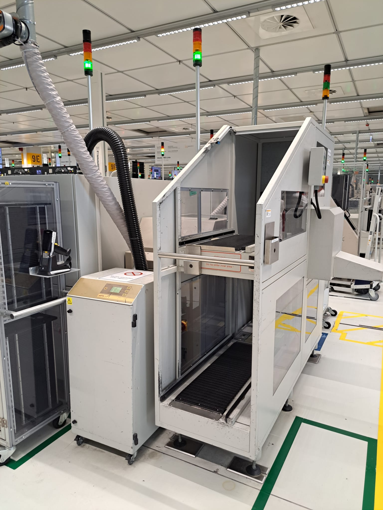

**Hauptkategorie:** Linienstationen. **Quelle:** Q001; Original: `Bilder/WhatsApp Image 2026-10-13 at 16.49.38.jpeg`.

**Sichtbar:** Linienstation mit zwei übereinander angeordneten schwarzen Förderflächen, vertikalem Aufbau und Signalgebern.

**Einordnung:** Möglicher Ein-/Ausgabebereich für Magazine; Funktion und Bewegungsablauf sind nicht belegt.

**Offen:** Richtung, Hersteller, Modell und Übergabehöhen offen.

**Schlagwörter:** Höhenwechsel; Zugang; Linienintegration

## B002 – Drei Magazinplaetze bestueckt

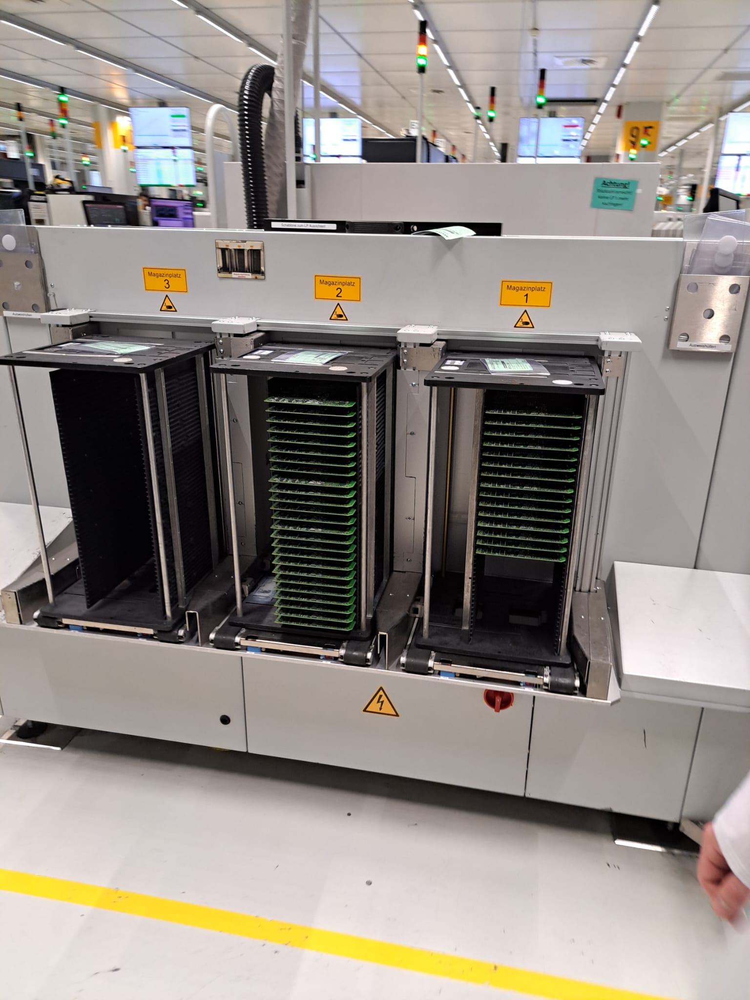

**Hauptkategorie:** Linienstationen. **Quelle:** Q010; Original: `Bilder/WhatsApp Image2 2026-10-13 at 16.49.38.jpeg`.

**Sichtbar:** Drei beschriftete Magazinplätze 1 bis 3. Schwarze Magazine stehen auf Förderflächen; zwei enthalten sichtbar Leiterplatten, eines wirkt leer.

**Einordnung:** Beispiel einer Linie mit gleichzeitig unterschiedlichen Füllständen.

**Offen:** Ein-/Ausgabeseite und tatsächlich nutzbare Magazinslots aus dem Foto nicht sicher.

**Schlagwörter:** Teilfüllung; drei Plätze; Losende; Identifikation

## B003 – Station zwei Foerderebenen Frontal

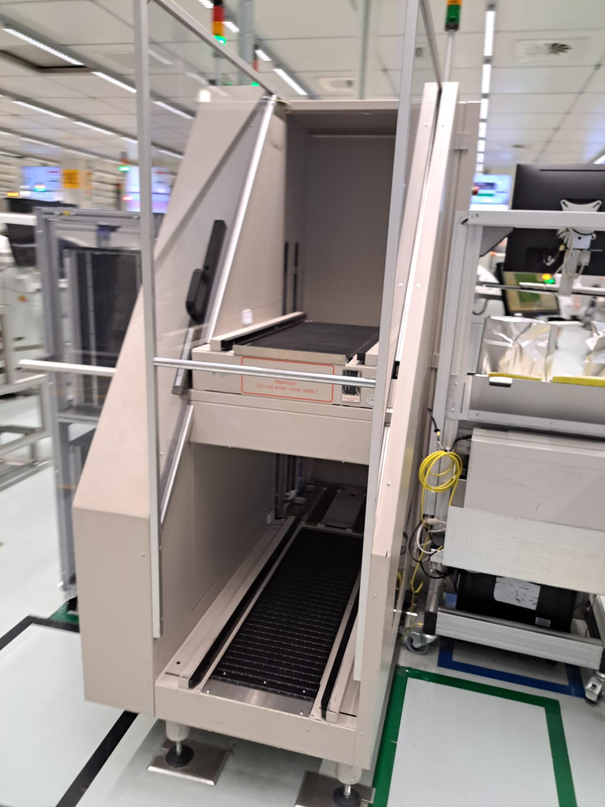

**Hauptkategorie:** Linienstationen. **Quelle:** Q011; Original: `Bilder/WhatsApp Image3 2026-10-13 at 16.49.39.jpeg`.

**Sichtbar:** Frontalansicht eines vertikalen Stationsaufbaus mit zwei Förderflächen und Schutzverkleidung.

**Einordnung:** Ergänzende Ansicht zur Geometrie der Station aus B001.

**Offen:** Gleichheit des konkreten Stationsmodells zu B001 ist visuelle Zuordnung, keine Identnummer.

**Schlagwörter:** Hub; Übergabeseite; Schutzbereich

## B004 – Station mit benachbartem Wagen

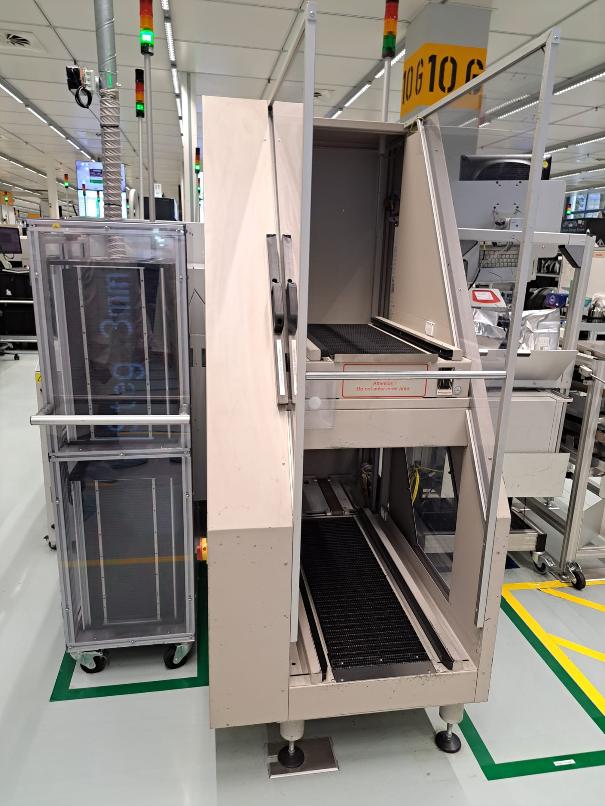

**Hauptkategorie:** Linienstationen. **Quelle:** Q012; Original: `Bilder/WhatsApp Image4 2026-10-13 at 16.49.39.jpeg`.

**Sichtbar:** Station mit zwei Förderflächen; links steht ein hoher rollbarer Träger mit zwei Ebenen.

**Einordnung:** Räumlicher Zusammenhang von Linie und Wagen, möglicher Übergabebereich.

**Offen:** Abstände und Höhen sind nicht vermessen; die gezeigte Aufstellung beweist keine automatische Übergabe.

**Schlagwörter:** Wagen; Andocken; Freiraum; Hub

## B005 – Drei leere Magazinplaetze Frontal

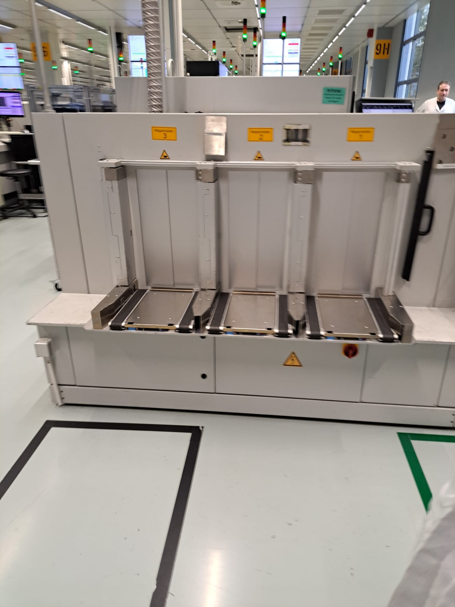

**Hauptkategorie:** Linienstationen. **Quelle:** Q013; Original: `Bilder/WhatsApp Image5 2026-10-13 at 16.49.39.jpeg`.

**Sichtbar:** Drei nummerierte leere Magazinplätze mit seitlichen Führungen und Förderbändern.

**Einordnung:** Zugängliche Aufnahmebereiche als Ausgangspunkt für eine externe Handhabung.

**Offen:** Antriebsrichtung, Entriegelung und vorhandene Maschinensignale sind offen.

**Schlagwörter:** Drei Plätze; Führung; Stationsübergabe

## B006 – Drei leere Magazinplaetze Schraeg

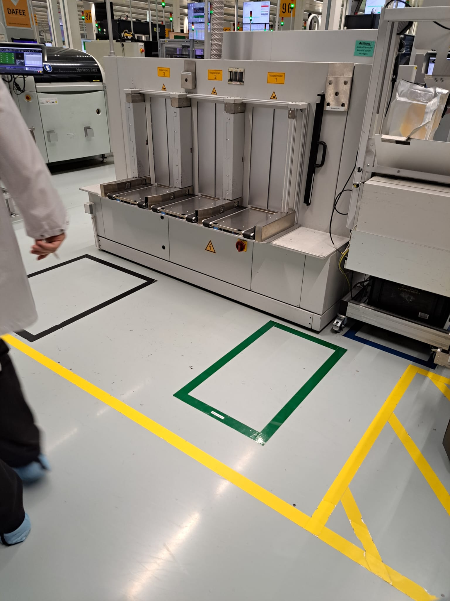

**Hauptkategorie:** Linienstationen. **Quelle:** Q014; Original: `Bilder/WhatsApp Image6 2026-10-13 at 16.49.39.jpeg`.

**Sichtbar:** Schrägansicht von drei leeren Magazinplätzen; Bodenmarkierungen und angrenzende Anlagen sind sichtbar.

**Einordnung:** Ergänzung von B005 zur räumlichen Integration und zu freizuhaltenden Flächen.

**Offen:** Bodenmarkierungen sind keine bemaßte oder freigegebene Layoutzeichnung.

**Schlagwörter:** Platzbedarf; Bedienzugang; Bodenmarkierung

## B007 – Schmales Transportfahrzeug im Fahrweg

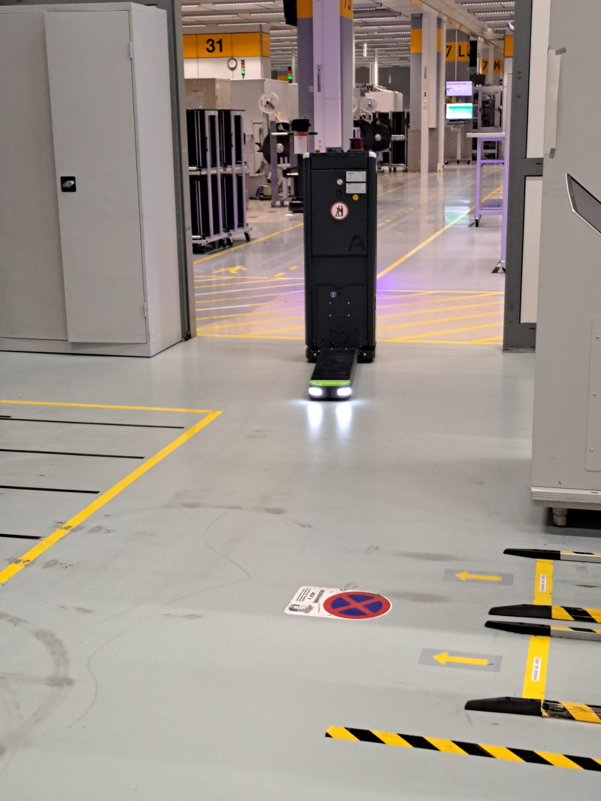

**Hauptkategorie:** Transport und Andocken. **Quelle:** Q015; Original: `Bilder/WhatsApp Image7 2026-10-13 at 16.49.40.jpeg`.

**Sichtbar:** Schmales dunkles Fahrzeug mit bodennahem Ausleger und Leuchten; daneben Fahrwegmarkierungen und bodennahe Führungen.

**Einordnung:** Möglicherweise der in den Notizen erwähnte Einzelmagazintransporter.

**Offen:** Zuordnung zu HVT, Traglast und Ein-Magazin-Beschränkung sind aus dem Bild nicht bestätigt.

**Schlagwörter:** Fahrweg; alternative Fahrzeuge; Bodenführung

## B008 – Lagerbereich Wagen und Uebergaben

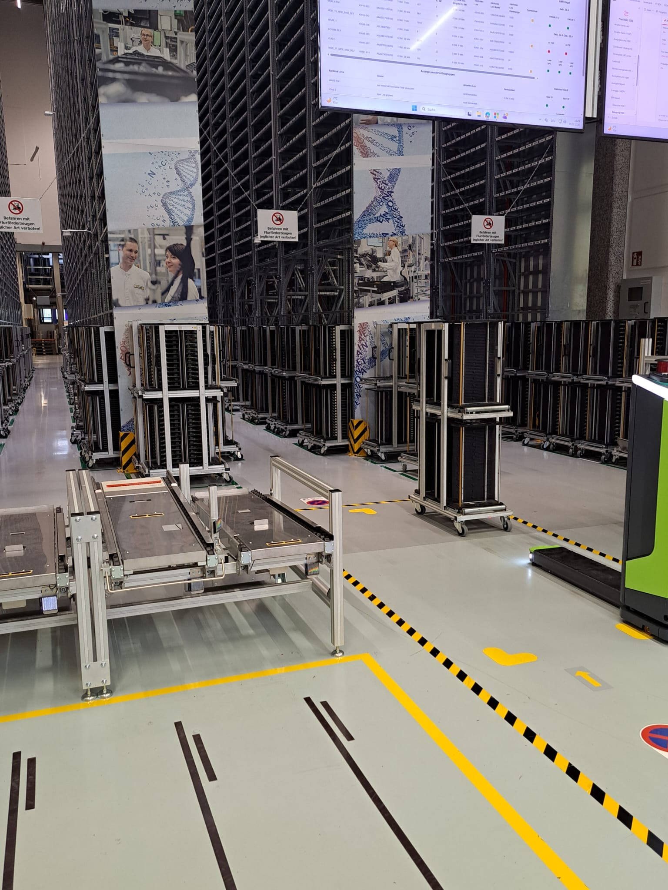

**Hauptkategorie:** Lager und Puffer. **Quelle:** Q016; Original: `Bilder/WhatsApp Image8 2026-10-13 at 16.49.40.jpeg`.

**Sichtbar:** Hohe Regalreihen, zahlreiche zweistöckige Wagen und mehrere stationäre Förderflächen im Vordergrund.

**Einordnung:** Bestehender Lager-/Bereitstellbereich und potenzielle Übergabeschnittstelle.

**Offen:** Regalinhalte, belegte Plätze und freie Kapazität sind nicht vollständig erkennbar.

**Schlagwörter:** Puffer; Wagenbestand; stationäre Übergabe

## B009 – Lagerbereich mit AGILOX

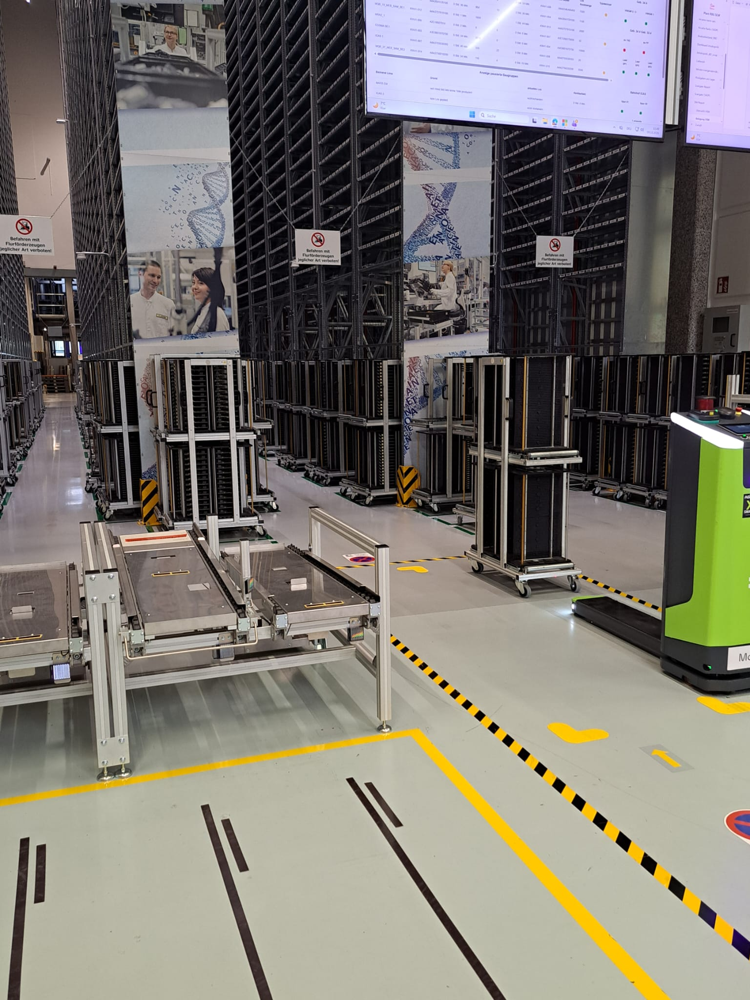

**Hauptkategorie:** Lager und Puffer. **Quelle:** Q017; Original: `Bilder/WhatsApp Image9 2026-10-13 at 16.49.40.jpeg`.

**Sichtbar:** Lagerbereich aus ähnlicher Perspektive wie B008; rechts steht ein grünes AGILOX-Fahrzeug neben einem Wagen.

**Einordnung:** Zusammenhang von Lager, Wagen und Fahrzeug.

**Offen:** Ähnliche Perspektive zu B008, aber keine identische Datei; reale Lagerkapazität nicht abzählbar.

**Schlagwörter:** Puffer; AGILOX; Andocken

## B010 – AGILOX Moritz am Wagen

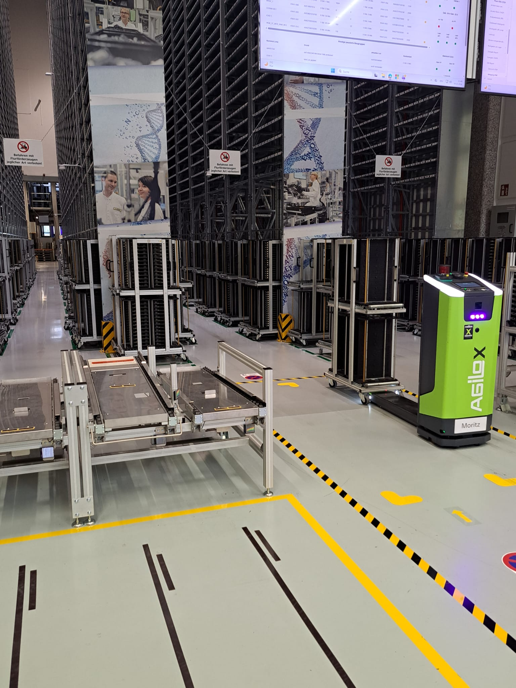

**Hauptkategorie:** Transport und Andocken. **Quelle:** Q002; Original: `Bilder/WhatsApp Image10 2026-10-13 at 16.49.40.jpeg`.

**Sichtbar:** Grünes Fahrzeug mit Schriftzug AGILOX und Namensschild Moritz vor einem Magazinwagen.

**Einordnung:** Dokumentiert die fahrzeugseitige Wagenaufnahme als relevanten Bestand.

**Offen:** Exakte Baureihe und Ausführung nicht anhand des Schriftzugs freigegeben.

**Schlagwörter:** AGILOX; Wagenaufnahme; Fahrweg

## B011 – AGILOX Moritz Wagenposition

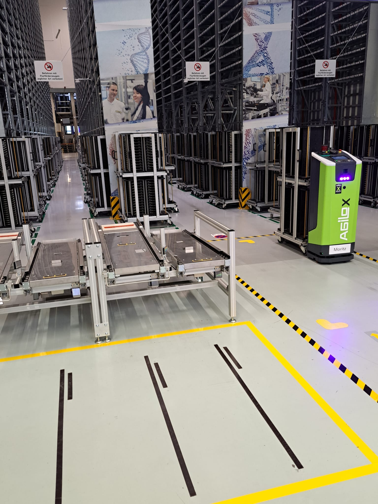

**Hauptkategorie:** Transport und Andocken. **Quelle:** Q003; Original: `Bilder/WhatsApp Image11 2026-10-13 at 16.49.41.jpeg`.

**Sichtbar:** AGILOX Moritz in unmittelbarer Nähe eines zweistöckigen Magazinwagens; Übergabeflächen links.

**Einordnung:** Weitere Position innerhalb einer visuell zusammengehörigen Aufnahmeserie.

**Offen:** Statische Bilder liefern keine Zykluszeit, Andockgenauigkeit oder Blockierungsquote.

**Schlagwörter:** Andocken; Wagen; Pufferanbindung

## B012 – AGILOX Moritz unter Wagen

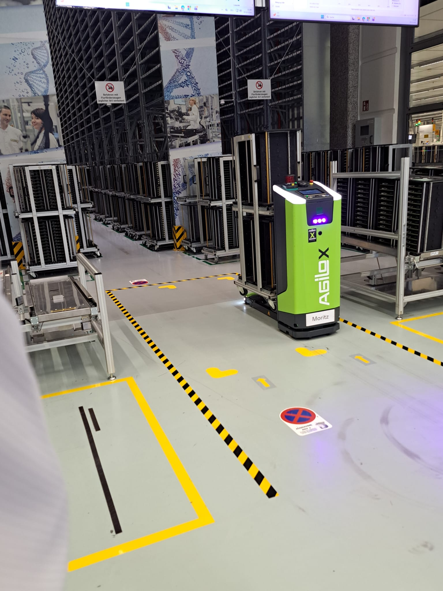

**Hauptkategorie:** Transport und Andocken. **Quelle:** Q004; Original: `Bilder/WhatsApp Image12 2026-10-13 at 16.49.42.jpeg`.

**Sichtbar:** AGILOX mit bodennahem Lastaufnahmeteil unter dem Magazinwagen; Wagen und Magazine stehen dicht am Fahrzeug.

**Einordnung:** Belegt die relevante mechanische Wagenaufnahme im vorhandenen System.

**Offen:** Hubzustand, zulässige Last und Fahrfreigabe sind nicht messbar.

**Schlagwörter:** Wagenaufnahme; Bestandskompatibilität; Unterfahrbereich

## B013 – Foerderuebergaben vor Lagerreihen

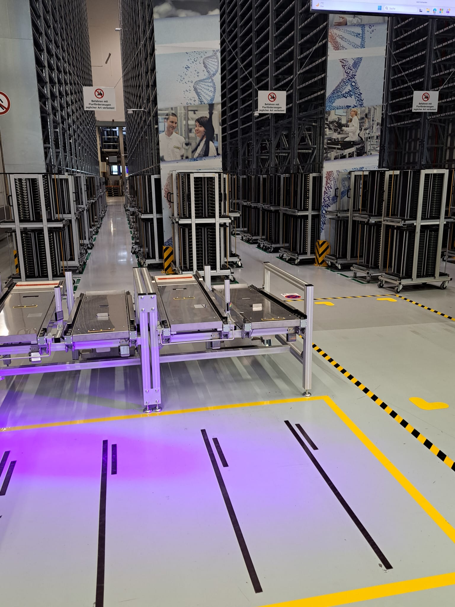

**Hauptkategorie:** Lager und Puffer. **Quelle:** Q005; Original: `Bilder/WhatsApp Image13 2026-10-13 at 16.49.42.jpeg`.

**Sichtbar:** Vier nebeneinander liegende Förder-/Auflagebahnen vor Regalreihen und Magazinwagen.

**Einordnung:** Mögliche stationäre Bereitstellung von Magazinen.

**Offen:** Funktion, Steuerung und Auslegung dieser Bahnen sind nicht dokumentiert.

**Schlagwörter:** Puffer; vier Übergabepositionen; Flächenbedarf

## B014 – Vier stationaere Uebergabebahnen

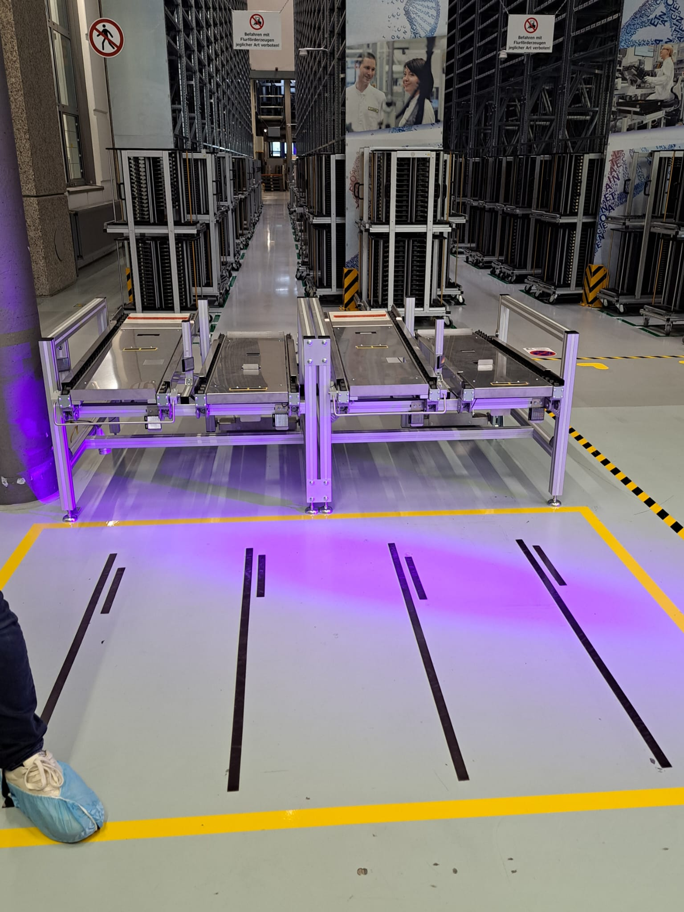

**Hauptkategorie:** Lager und Puffer. **Quelle:** Q006; Original: `Bilder/WhatsApp Image14 2026-10-13 at 16.49.43.jpeg`.

**Sichtbar:** Frontansicht von vier stationären Bahnen mit unterschiedlichen Auflagehöhen und seitlichen Führungen.

**Einordnung:** Ansatzpunkt für Prüfung von Übergabemodulen und Zwischenpufferung.

**Offen:** Sichtbare Auflagehöhen sind nicht als Wagenhöhen oder zulässige Schnittstellenmaße zu übernehmen.

**Schlagwörter:** Übergabemechanik; Puffer; Höhen

## B015 – Wagen Rollenbahn Detail

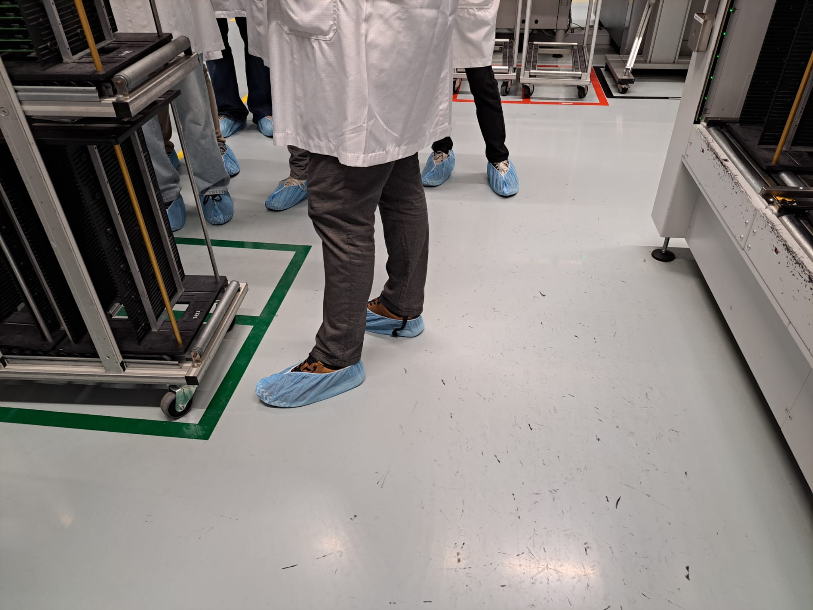

**Hauptkategorie:** Magazinwagen und Uebergabemechanik. **Quelle:** Q007; Original: `Bilder/WhatsApp Image15 2026-10-13 at 16.49.43.jpeg`.

**Sichtbar:** Detail eines Wagens mit unterer Auflage, Rollen und Lenkrolle; weitere Wagen und Station im Hintergrund.

**Einordnung:** Rollenunterstützte Verschiebung ganzer Magazine könnte nutzbar sein.

**Offen:** Rollen sind sichtbar; Antrieb, Rollwiderstand, Anschläge und Verriegelungen bleiben offen.

**Schlagwörter:** Rollenbahn; Unterbau; Räder; Übergabe

## B016 – Wagen zwei Ebenen Detail

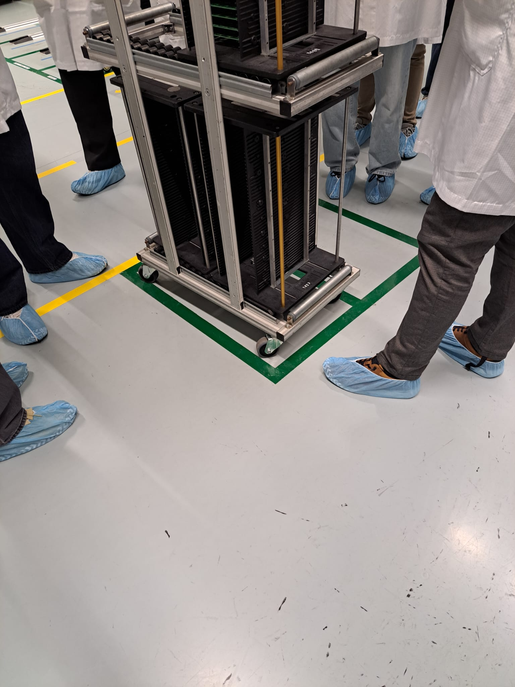

**Hauptkategorie:** Magazinwagen und Uebergabemechanik. **Quelle:** Q008; Original: `Bilder/WhatsApp Image16 2026-10-13 at 16.49.43.jpeg`.

**Sichtbar:** Wagen mit zwei Ebenen, mehreren Magazinen, seitlichen Rahmenprofilen, Auflagerollen und Lenkrollen.

**Einordnung:** Zentrale Referenz für zwei horizontale Positionen je Ebene und die Höhenanpassung.

**Offen:** Vier Plätze sind durch Notizen/Folien beschrieben. Zulässige Kräfte, Maße und Sicherungen müssen vermessen werden.

**Schlagwörter:** Zwei Ebenen; vier Plätze; Rollen; Magazinrahmen

## B017 – Drei Magazinplaetze mit Sensorik

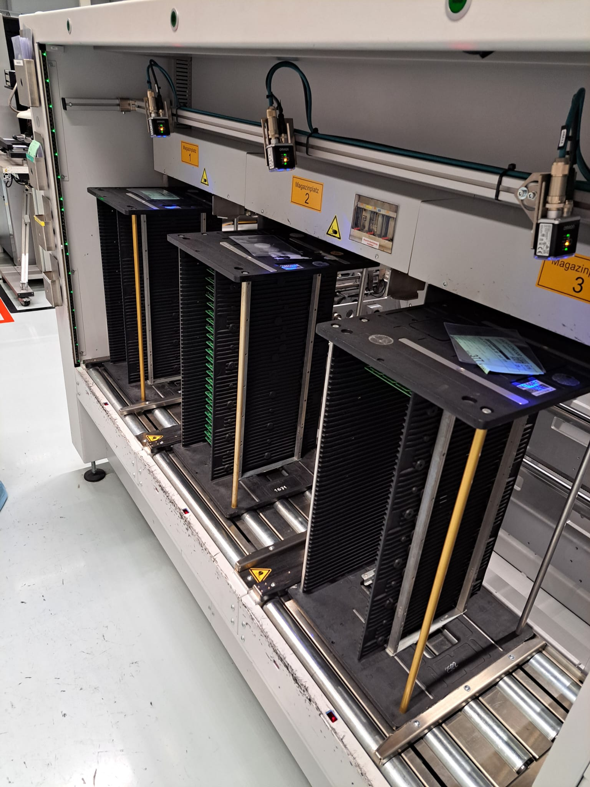

**Hauptkategorie:** Linienstationen. **Quelle:** Q009; Original: `Bilder/WhatsApp Image17 2026-10-13 at 16.49.44.jpeg`.

**Sichtbar:** Drei nummerierte Magazinplätze auf Rollenbahnen; darüber Sensor-/Leseköpfe mit sichtbarem OMRON-Schriftzug.

**Einordnung:** Vorhandene Identifikations-/Überwachungskomponenten sind Ansatzpunkt für digitale Übergabe.

**Offen:** Lesefunktion, Protokoll und tatsächlicher Dateninhalt sind nicht aus dem Foto bewiesen.

**Schlagwörter:** Rollenbahn; Identifikation; Sensorik; Füllstand

