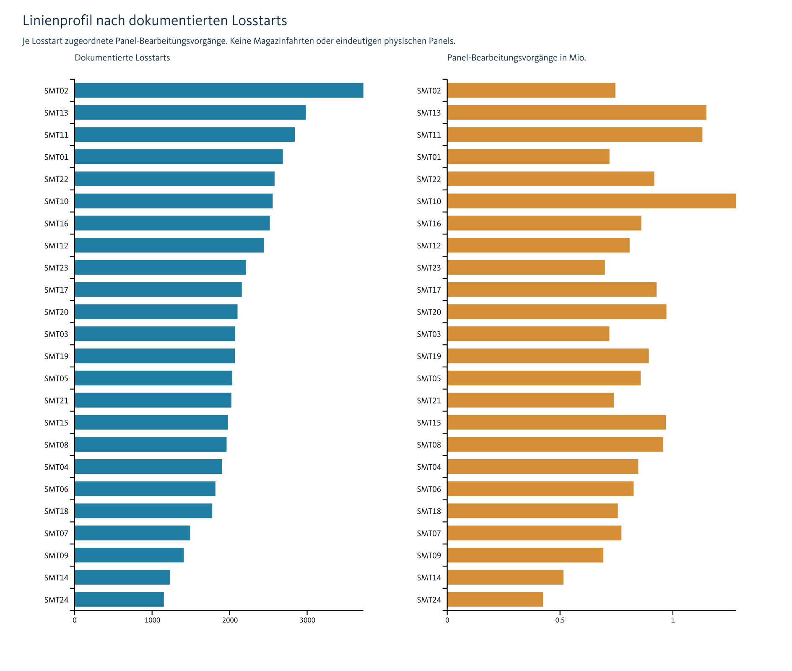
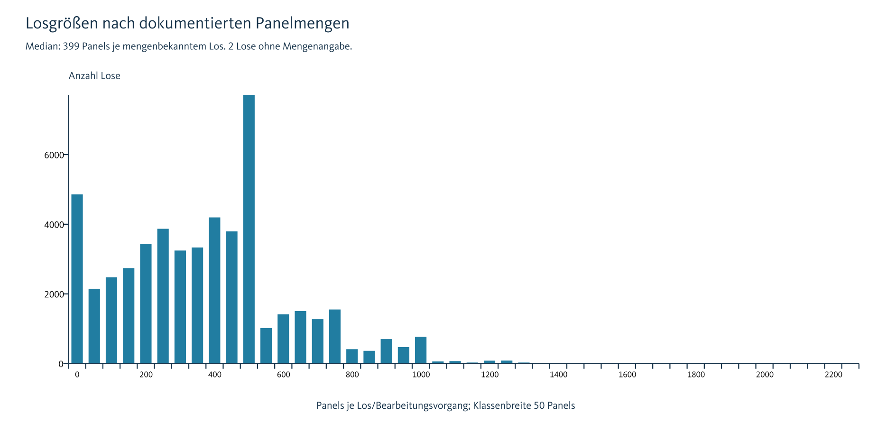
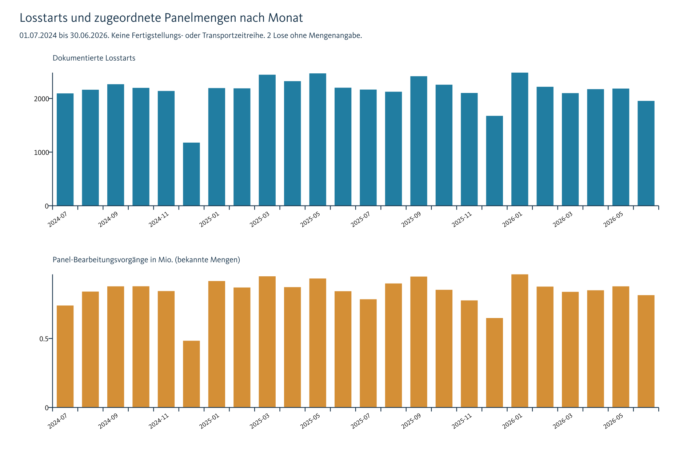
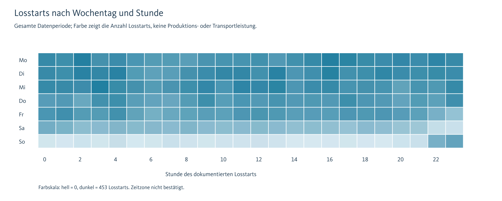

# Auswertung der Bewegungsdaten

Stand: 29.10.2026. Quelle Q018: `Daten/Bewegungsdaten AUMOVIO.xlsx`, Blätter `SMD Lots` und `Backend-Productdata`. [Zur Übersicht](../README.md).

## Ergebnis und Aussagegrenze

Die Datei umfasst **51.714 eindeutige LOTID** mit Losstarts von **01.07.2024 bis 30.06.2026**, 24 SMT-Linien und 559 BOARDTYPE. Sie beschreibt Produktionslose und Stammdaten. **Ein Los ist kein einzelner Magazintransport.** Es fehlen Magazin-IDs, tatsächliche Übergabe-/Endzeitpunkte, eine verlässliche Verbindung physischer Panels über beide Seiten und tatsächliche Backend-Verbrauchsereignisse.

Die bekannte Summe beträgt **20.175.629 Panel-Bearbeitungsvorgänge**. 2 Lose ohne Mengenangabe. Die bekannte Mengensumme ist unvollständig. Zugleich ist sie keine Zahl eindeutiger physischer Panels: erneute Seitenbearbeitungen können dasselbe Material erneut enthalten.

## Losgrößen und Linien

- Median: 399 Panels je mengenbekanntem Los.
- 95. Perzentil: 875,0 Panels; Maximum: 2.265 Panels.
- Das Perzentil beschreibt Losgrößen, keine notwendige Förderleistung.

| Linie | Lose | Bekannte Panel-Bearbeitungsvorgänge |
| --- | --- | --- |
| SMT02 | 3.725 | 745.374 |
| SMT13 | 2.983 | 1.148.515 |
| SMT11 | 2.842 | 1.131.083 |
| SMT01 | 2.687 | 719.221 |
| SMT22 | 2.580 | 917.585 |
| SMT10 | 2.556 | 1.280.140 |
| SMT16 | 2.518 | 860.307 |
| SMT12 | 2.440 | 808.573 |

## Zeitliche Verteilung

Die Mengen werden vollständig der Stunde/dem Tag/dem Monat des **Losstarts** zugeordnet. Ein großes Los ist über seine Laufzeit verteilt gefertigt worden; diese Auswertung verteilt es mangels belegter Laufzeitdaten nicht künstlich auf Produktionsstunden. Schichtauslastung, tatsächliche Fertigstellungsspitzen und Transportspitzen folgen daraus nicht.

Der größte beobachtete Tageswert sind **130 Losstarts am 24.11.2025**. Der größte Stundenwert sind **15 Losstarts am 13.10.2025 um 02:00**. Das sind Losstart-Häufungen. Tages- und Stundentabellen umfassen auch Kalenderintervalle ohne Datensätze. Null bedeutet dort keine dokumentierten Losstarts; daraus folgt kein Stillstand.

## Zwischenziele und Backend

**19.631 Lose** tragen `INTERMEDIATETARGET=1`. Bei 10.590 davon sind LINE und TARGETLINE gleich. Das weist keine Fahrt zwischen verschiedenen Linien nach und darf nicht pauschal als solche gezählt werden. Bei fehlendem Zwischenziel wird ebenfalls kein sicherer Backend-Abgang unterstellt.

Das Backend-Blatt enthält 2.476 Zeilen, nach transparenter Bereinigung 2.475 Zuordnungszeilen, verteilt auf 53 Linien. 1 vollständig identische Backend-Dublette. Für **406 von 559 BOARDTYPE** existiert ein exakter Stammdatenmatch. Das betrifft **44.398 von 51.714 Losen (85,9 %)**. 153 BOARDTYPE mit 7.316 Losen haben keinen exakten Match.

**154 BOARDTYPE** besitzen mehrere mögliche Backend-Linien. Selbst bei `ISDEFAULT=1` gibt es für 45 BOARDTYPE mehrere Linien. Ein Stammdatenmatch beweist weder den tatsächlichen nächsten Prozess noch eine konkrete Verbrauchszeit. Mögliche Ziele werden daher listenweise erhalten. Es erfolgt keine vervielfachende Mengenaggregation durch einen 1:n-Join.

## Datenqualität und Nachrechnung

Einzelbefunde zu Mengenlücken und Dubletten stehen mit Quellzeilen in [Einzelauffaelligkeiten.csv](Tabellen/Einzelauffaelligkeiten.csv). Alle 51.714 Lose bleiben in der aufbereiteten Tabelle erhalten. Keine LOTID-Dublette wurde gefunden. Bei vorhandenen Mengen gilt überall `REALAMOUNT = NUMBERPERPANEL × NUMBEROFPANELSINLOT`.

Die Sekundenumrechnung und Auswahlregeln der Quellenformeln wurden aus den Basiswerten unabhängig nachgerechnet. Ergebnis: 0 Abweichungen in den geprüften SMT-Feldern und 0 in den Backend-Zeitfeldern. Dies prüft die Übereinstimmung mit gespeicherten Ergebnissen, nicht die physische Bedeutung der Zeiten. Keine Neuberechnung oder Speicherung der Originalarbeitsmappe.

`REALSTART` wird mit bis zu neun Nachkommastellen eingelesen und zusätzlich als ISO-Zeit exportiert; der Originaltext bleibt erhalten. Die Zeitzone ist nicht belegt. Keine Umrechnung nach UTC und keine erfundene Sommerzeitkorrektur. `Stunde` stimmt in allen Zeilen mit der abgerundeten lokalen Textzeit überein.

## Magazinbedarf und Puffer

Die Kapazitätsvorlage enthält **1000 Produktschlüssel aus BOARDTYPE, SIDE und REVISION**. Aktuell sind **0 Lose** im Magazinmodell berechenbar. Solange Kapazitäten fehlen, bleiben Ergebnisse leer und tragen einen konkreten Fehlgrund. Die vier Wagenplätze sind eine Arbeitsannahme aus Q019/Q020, keine vermessene Freigabe.

Die Formeln und Rechenbeispiele stehen in [Bedarfsmodelle.md](Bedarfsmodelle.md). Beispielkapazitäten sind ausdrücklich hypothetisch; sie werden nicht auf die historischen Lose übertragen. Reale Pufferkapazität und Fahrzeugzahl bleiben offen. Das Backend-Blatt liefert keine beobachtete Abnahmehistorie.

## Reproduktion und Tabellen

Auswertung: `Reproduktion/auswerten.py`. Benötigt werden Python, openpyxl, pandas, numpy und ReportLab sowie der gebündelte Sharp-Renderer. Die verwendeten Versionen sowie Quellprüfsumme und Kontrollsummen stehen in [Kennzahlen_und_Pruefungen.json](Kennzahlen_und_Pruefungen.json). Startanleitung: [Reproduktion/README.md](Reproduktion/README.md).

Tabellen: aufbereitete Lose, deduplizierte Backend-Zuordnungen, Monats-/Wochen-/Tages-/Stundenwerte, Linienprofil, beobachtete Linie-Tag-Kombinationen, Produktmix, Zwischenzielmatrix, Seite/Reihenfolge, Mappingabdeckung, Einzelauffälligkeiten und Magazinmodell. CSV: UTF-8 mit BOM, Komma als Feldtrenner, Dezimalpunkt. Leeres Zahlenfeld bedeutet fehlend, nicht null. `QUELLZEILE` verweist auf die Original-Excelzeile. Die Linie-Tag-Tabelle enthält nur beobachtete Kombinationen; die Gesamt-Tages-/Stundentabellen enthalten alle Kalenderintervalle der Periode.
