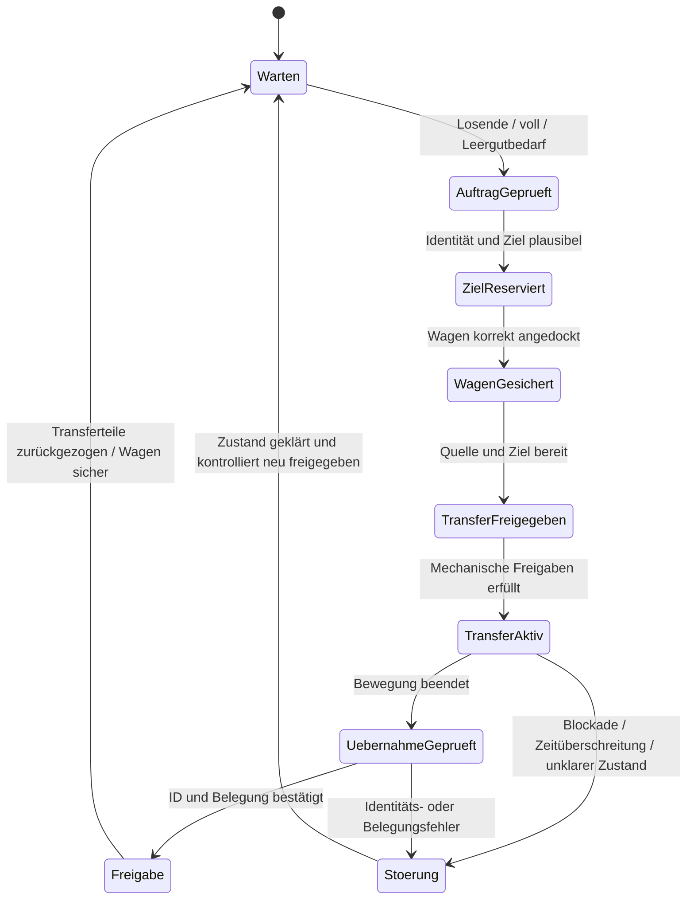

# Konzeptionelle Schnittstellen und Betriebsfälle

Stand: 29.10.2026. Dieses Dokument beschreibt benötigte Informationen und Freigaben. Es behauptet kein vorhandenes Protokoll und ist keine SPS-Spezifikation. Die tatsächlichen Schnittstellen müssen mit F04/F09 geklärt werden.

## Informationsübergaben

| Beteiligte Systeme | Benötigte Informationen / Freigaben | Warum nötig |
|---|---|---|
| Linie → Transferstation | Stations-/Platz-ID, Magazin-ID, Los/Produkt/Revision/Seite soweit verfügbar, belegte Menge, voll/Losende/leer/gesperrt, Übergabebereitschaft | Magazinwechsel vom reinen „voll“-Signal unterscheiden und richtige Einheit übernehmen |
| Disposition/MES → Auftrag | Ziel, erlaubte Reihenfolge und Mischung, Freigabezeit/Priorität, Pufferziel und Auftragskennung | Kein Warten auf vier Magazine erzwingen und falsches Ziel verhindern |
| Wagen/Transferstation → Logik | Wagen-ID, vier Platzidentitäten mit Ebene/Position, tatsächliche Belegung, Dock-/Verriegelungszustand, korrekte Magazinposition | Wagenbelegung und Magazinfüllstand getrennt verfolgen |
| Transferstation ↔ Linie | Anfrage, Übernahmebereitschaft, mechanische Freigabe, Transfer aktiv, Übernahme bestätigt, Fehler/Abbruch | Kein gleichzeitiger Zugriff beider Systeme auf dasselbe Magazin |
| Transferstation ↔ AGV-System | Wagenanforderung, Ziel-/Dockplatz, Wagen übergeben, sicher zur Abfahrt, Abholung/Ankunft bestätigt, Störung | Fahrzeug erst nach sicherem Abschluss freigeben; Warteaufträge außerhalb kritischer Fahrwege |
| Zielstation/Puffer ↔ Disposition | Aufnahmeplatz reserviert, Magazin angekommen, Übergabe bestätigt, Bedarf/Abnahme, Sperre | Keine Abfahrt zu einem ungeklärten oder vollen Ziel |

Wenn eine zentrale Magazin-ID fehlt, muss vor dem Pilot geklärt werden, wie eine eindeutige Identität erzeugt und mit dem physischen Magazin verbunden wird. Aus einem Foto eines Lesekopfes wird kein funktionierender digitaler Zwilling abgeleitet.

## Gemeinsamer Übergabeablauf

Die Zustände „mechanisch gesichert“ und „Übernahme bestätigt“ benötigen reale Rückmeldungen. Eine reine Zeitverzögerung ersetzt sie nicht. Aufträge müssen Wiederholungen/Kommunikationsabbrüche erkennen, damit derselbe physische Transfer nicht doppelt ausgelöst wird. Nach einem Abbruch wird aus Sensorzustand und Magazinidentität rekonstruiert, wo das Magazin tatsächlich steht.

## Betriebs- und Störfälle für die spätere Abnahme

| Fall | Erwartetes Verhalten des Konzepts | Nachweis |
|---|---|---|
| Ein bis vier Magazine, unterschiedliche Ebenen | Eindeutige Platzzuordnung; nur freigegebene Belegung transportieren | Alle zulässigen Belegungsbilder mit Vollgewicht prüfen |
| Losende vor vollem Magazin oder Wagen | Teilmenge sicher abschließen und gemäß Disposition freigeben | Keine globale Vollwagenpflicht, Mengen erhalten |
| Volles Magazin während Wagenwechsel | Weiterlauf nur bei tatsächlich verfügbarem Puffer; sonst definierte Rückmeldung an Linie | Tatsächliche Wechsel-/Abholzeiten, freie Slots |
| Leeres Magazin an Eingabe benötigt | Passendes Leergut bereitstellen und Auftrag quittieren | Keine Verwechslung mit teilgefülltem Material |
| Falsches Ziel/Produkt oder gesperrte Ware | Transfer nicht ohne Klärung starten; Ausnahmeauftrag sichtbar | Identitäts-/Routingprobe |
| Zielpuffer voll oder Abnahme verspätet | Kein unreservierter Transport in blockierten Bereich; Rückstau geordnet behandeln | Gleichzeitigkeit und Ausweich-/Warteflächen prüfen |
| Magazin verkantet / unerwartete Kraft | Bewegung kontrolliert unterbrechen, Last sichern, Zustand klären | Mechanischer Versuch und Bedienkonzept |
| Wagen falsch positioniert / Räder ungünstig | Transfer nicht freigeben, Wagenposition korrigieren | Toleranz- und Radstellungsfälle |
| AGILOX verspätet oder ausgefallen | Aufträge sichtbar halten, Linienreserve nutzen, definierter Handbetrieb nach Freigabe | Wartezeitgrenzen und Leergutversorgung |
| Kommunikation bricht vor Quittierung ab | Keine blinde Wiederholung; physische Belegung und Auftrags-ID abgleichen | Abbruch an jeder Übergabephase |
| Bedienung/Wartung im Bewegungsbereich | Geprüfter Zugang und kontrollierter Wiederanlauf | Fachprüfung des vollständigen Schutz-/Bedienkonzepts |

Diese Fälle dienen der Konzeptvalidierung. Konkrete Sicherheitsfunktionen, Grenzkräfte und Freigaben werden erst mit der verantwortlichen Anlagen-/Sicherheitstechnik festgelegt.
